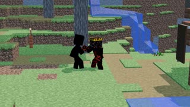

# A random Blender animation between THE APEX tasks. · personal-video-10

[Watch the full video](https://farlandgame.github.io/Personal-Portfolio/?lang=en#personal-video-10) · [MP4](../videos/personal-video-10.mp4)

A random Blender animation between THE APEX tasks. 😂🎬

This clip is a shared joke between me, my friend and collaborator Ali Dehghannejad (Alivexor), and my twin brother Armiya. Ali made the animation in Blender.

I called Ali while I was working on THE APEX’s code and said I would let him know when I was finished so I could give him the map work. He asked how long it would take. I estimated about two hours. His response was essentially: “Two hours? What am I supposed to do until then?” I told him there was nothing to do for the moment, but he was not very satisfied with that answer.

So I suggested he sit down with Blender and make a random animation of us. This wonderfully silly little fantasy was the result. It is a playful behind-the-scenes memory of working together on THE APEX. Apparently “make something random” is a perfectly workable creative brief! 😂

[Ali Dehghannejad / Alivexor · GitHub](https://github.com/Alivexor)

[Video stories](videos.md)
