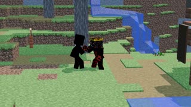

# از «فعلاً کاری نیست» تا یک انیمیشن رندوم برای THE APEX! · personal-video-10

[تماشای ویدئوی کامل](https://farlandgame.github.io/Personal-Portfolio/?lang=fa#personal-video-10) · [MP4](../videos/personal-video-10.mp4)

از «فعلاً کاری نیست» تا یک انیمیشن رندوم برای THE APEX! 😂🎬

این کلیپ یک شوخی بین من، علی دهقان‌نژاد با نام هنری Alivexor و ارمیا، برادر دوقلویم، است. خود انیمیشن را علی با Blender ساخته است.

به علی زنگ زدم و گفتم دارم روی کدهای THE APEX کار می‌کنم؛ تمام شد خبرت می‌کنم بیایی تا کار مپ‌ها را به تو بدهم. پرسید: «بردیا، چقدر طول می‌کشه؟» گفتم: «یه دو ساعت.» گفت: «دو ساعت؟ پس من چیکار کنم؟» گفتم فعلاً کاری نیست؛ ولی علی با «فعلاً کاری نیست» خیلی کنار نیامد!

آخرش گفتم بنشین با بلندر یک انیمیشن رندوم از خودمان بساز. علی هم این چیز بامزه، فانتزی و عمداً مسخره را ساخت. یک یادگاری از شوخی‌های پشت‌صحنهٔ کار مشترکمان روی THE APEX؛ ظاهراً «یه چیز رندوم بساز» هم می‌تواند شرح پروژه باشد! 😂

[Ali Dehghannejad / Alivexor · GitHub](https://github.com/Alivexor)

[Video stories](videos.md)
