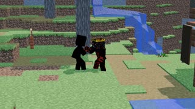

# THE APEXの作業の合間に生まれた、Blenderのランダムな一本。 · personal-video-10

[動画の全編を見る](https://farlandgame.github.io/Personal-Portfolio/?lang=ja#personal-video-10) · [MP4](../videos/personal-video-10.mp4)

THE APEXの作業の合間に生まれた、Blenderのランダムな一本。😂🎬

私と、友人で共同制作者のAli Dehghannejad（Alivexor）、双子の弟Armiyaの間の冗談のようなクリップです。アニメーションをBlenderで制作したのはAliです。

THE APEXのコードを書いていた私はAliに電話し、終わったら知らせてマップの作業を渡すと伝えました。どれくらいかかるか聞かれ、私は2時間くらいと見積もりました。するとAliは「2時間？ その間、何をしていればいいの？」という反応。今は特に作業がないと答えましたが、それではあまり納得していない様子でした。

そこで、Blenderで自分たちのランダムなアニメーションを作ってみたら、と提案しました。その結果が、このふざけていて面白い小さなファンタジーです。THE APEXを一緒に作る舞台裏の、遊び心のある思い出。「何かランダムに作って」も、ちゃんと制作のお題になるようです！😂

[Ali Dehghannejad / Alivexor · GitHub](https://github.com/Alivexor)

[Video stories](videos.md)
