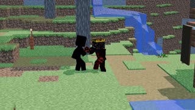

# Шутливая анимация Али · personal-video-10

Краткий перевод рассказа автора.

[Смотреть целиком](https://farlandgame.github.io/Personal-Portfolio/?lang=ru#personal-video-10) · [MP4](../videos/personal-video-10.mp4)

Шутливая Blender-анимация Али Дехганнежада (Alivexor) о нас с Армией. Я работал над кодом THE APEX и обещал позже передать Али задачи по карте. Он спросил, сколько ждать; я ответил: около двух часов. «А что мне делать эти два часа?» — «Сделай в Blender какую-нибудь случайную анимацию про нас». Этот забавный маленький фантазийный ролик и стал результатом. Оказывается, «сделай что-нибудь случайное» — тоже рабочий бриф! 😂🎬

[Ali Dehghannejad / Alivexor · GitHub](https://github.com/Alivexor)

[Истории всех видео](README.ru.md)
