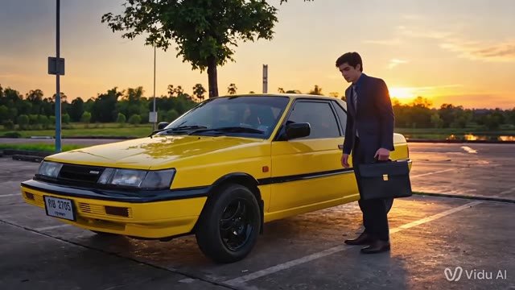

# A cinematic self-portrait inspired by Better Call Saul. · personal-video-12

[Watch the full video](https://farlandgame.github.io/Personal-Portfolio/?lang=en#personal-video-12) · [MP4](../videos/personal-video-12.mp4)

A cinematic self-portrait inspired by Better Call Saul. 🎬

This is the film behind images 001–004 and 111. My inspiration was a scene from Better Call Saul and Saul Goodman, a character I admire and see as a role model. I wanted to make my own version of a cinematic self-portrait.

I did not have a suitable camera or the budget for the shoot I imagined. I worked with Photoshop and several AI video tools instead, spending about two weeks bringing the project together. The images in the gallery belong to scenes from this same project.

For me, it is a record of working through the limitations of the equipment I had to bring an idea to the screen. The published video is the complete supplied clip; the images and this film can be explored together.

[001](personal-001.en.md) · [002](personal-002.en.md) · [003](personal-003.en.md) · [004](personal-004.en.md) · [111](personal-111.en.md)

[Video stories](videos.md)
