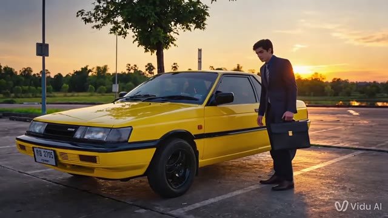

# یک پرترهٔ سینمایی با الهام از Better Call Saul. · personal-video-12

[تماشای ویدئوی کامل](https://farlandgame.github.io/Personal-Portfolio/?lang=fa#personal-video-12) · [MP4](../videos/personal-video-12.mp4)

یک پرترهٔ سینمایی با الهام از Better Call Saul. 🎬

این همان فیلمی است که عکس‌های ۰۰۲ تا ۰۰۴ و ۱۱۱ به صحنه‌هایش مربوط می‌شوند. الهامم بخشی از سریال بتر کال سال و سال گودمن بود؛ شخصیتی که دوستش دارم و الگوی من است. می‌خواستم فیلمی با حضور و حال‌وهوای خودم بسازم.

دوربین مناسب و بودجهٔ فیلم‌برداری‌ای که در ذهنم بود را نداشتم. با Photoshop و چند ابزار هوش مصنوعیِ فیلم‌ساز کار کردم و حدود دو هفته برای جمع‌کردن این پروژه وقت گذاشتم. تصویرهای گالری هم مربوط به صحنه‌های همین کار هستند.

برای من این پروژه یادگاریِ تلاش برای رسیدن از یک ایده به تصویر، با همان امکاناتی است که داشتم. نسخهٔ منتشرشده، کلیپ ارسالی را به‌طور کامل نگه داشته و حالا فیلم و عکس‌هایش کنار هم قابل دیدن‌اند.

[002](personal-002.fa.md) · [003](personal-003.fa.md) · [004](personal-004.fa.md) · [111](personal-111.fa.md)

[Video stories](videos.md)
